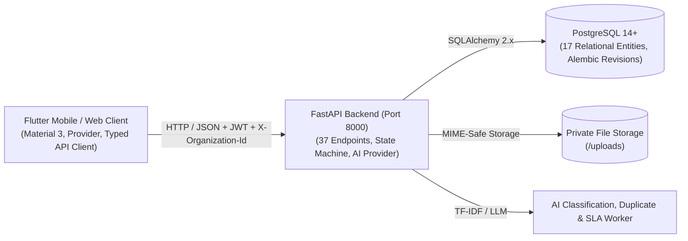

# Quibble Hub — Universal Complaint Management System
### With AI-Assisted Classification, Intelligent Routing, and Resolution Tracking
**Final-Year Engineering Capstone Project**

[](https://fastapi.tiangolo.com)
[](https://flutter.dev)
[](https://www.postgresql.org)
[](https://pytest.org)
[](https://flutter.dev)

---

## 1. Project Overview

The **Universal Complaint Management System** is a production-grade, multi-tenant enterprise grievance redressal platform engineered for modern organizations. Built specifically to eliminate the chaos of unmonitored email threads, manual triage, and lost tracking IDs, the system provides an end-to-end audit-logged lifecycle for filing, investigating, and resolving grievances with zero data leakage between tenants.

The system natively supports four institutional domains on a single platform:
1. **Colleges & Universities (`COLLEGE`):** Academic grievances, lab/equipment outages, hostel issues, and maintenance.
2. **Commercial Enterprises (`BUSINESS`):** E-commerce delivery issues, logistics tracking, refunds, and product defects.
3. **Public Services & Municipalities (`PUBLIC_SERVICE`):** Potholes, road hazards, water supply contamination, waste management.
4. **Corporate Workplaces (`CORPORATE`):** IT infrastructure, software licenses, HR ethics, facilities.

---

## 2. Technology Stack

### Mobile & Desktop Frontend
- **Framework:** Flutter 3.47.1 & Dart 3.13.1 (Material 3 Design Tokens)
- **State Management:** Provider Architecture with reactive view-models (`AuthProvider`, `ComplaintProvider`)
- **API Client:** Centralized HTTP client with automatic JWT token management, 401 refresh session recovery, tenant context injection (`X-Organization-Id`), and platform-aware base URL resolution.
- **Form Handling:** Typed validators, debounce search, live chip filters, and reactive duplicate detection.

### Backend Application
- **Language & Framework:** Python 3.11+ / 3.14 with FastAPI 0.115+
- **Database & ORM:** PostgreSQL 14+ with SQLAlchemy 2.x and Alembic schema migrations
- **Authentication & Security:** JWT Access Tokens, bcrypt password hashing, revocable refresh token sessions stored in PostgreSQL.
- **Workflow Engine:** Strict state machine with 8 distinct statuses, atomic database transitions, and immutable audit logging.
- **Automated Testing:** Pytest 9.1 with HTTPX Async/Sync client fixtures.

### AI Engine & Supporting Workers
- **AI Classification & Summarization:** Dual-mode provider architecture supporting Google Gemini 1.5 / OpenAI and an offline local NLP heuristic engine.
- **Duplicate Detection:** `scikit-learn` TF-IDF Vectorizer with pairwise cosine similarity calculation.
- **Background SLA Worker:** Idempotent escalation worker detecting first-response and resolution deadline breaches.

---

## 3. Major Features

- **Multi-Tenant Isolation:** Dynamic organization switching with zero data crossover, verified by dedicated security tests.
- **Collision-Safe Tracking Numbers:** Format `ORG-YYYY-XXXX` generated inside atomic transactions to eliminate race conditions.
- **Role-Adaptive Experiences:**
  - *Complainants:* Fast complaint filing, AI assistant, duplicate warnings, live status timeline, feedback rating.
  - *Staff / Handlers:* Assigned queues, internal staff-only notes, investigation updates, resolution summaries.
  - *Managers & Admins:* Department-level routing, staff assignment, SLA policy enforcement, real-time analytics.
- **Reactive AI Assistant:** Auto-suggests category, department, and priority directly from grievance descriptions; alerts users to existing duplicate complaints before submission.
- **Private Attachment Storage:** Safe file uploads with MIME-type verification, extension whitelisting, and authorized downloads.
- **One-Tap Demo Personas:** Embedded quick-fill buttons on the login screen for instant viva evaluations.

---

## 4. Architecture Overview



For full architecture diagrams, ER models, and state machine transition tables, see [`docs/architecture.md`](file:///d:/complaint_management_app/docs/architecture.md).

---

## 5. Repository Structure

```
complaint_management_app/
├── backend/
│   ├── alembic/                # Database migration scripts & env
│   ├── app/
│   │   ├── api/v1/             # REST Routers (auth, complaints, orgs, depts, ai, etc.)
│   │   ├── ai/                 # AI provider, duplicate detection, local NLP fallback
│   │   ├── core/               # Configuration, security, JWT, password hashing
│   │   ├── db/                 # SQLAlchemy session and Base model
│   │   ├── models/             # 17 Relational entities and enum definitions
│   │   ├── schemas/            # Pydantic v2 request & response models
│   │   ├── services/           # State machine workflow & unique ID generator
│   │   └── workers/            # SLA escalation and background tasks
│   ├── tests/                  # 18 Pytest unit and tenant isolation tests
│   ├── requirements.txt        # Pinned Python dependencies
│   ├── Dockerfile              # Backend container definition
│   └── seed.py                 # Deterministic multi-tenant seed script
├── frontend/
│   ├── lib/
│   │   ├── core/api/           # Centralized API Client & platform networking
│   │   ├── core/theme/         # Custom Material 3 color system & typography
│   │   ├── models/             # Dart data models
│   │   ├── providers/          # Auth and Complaint State Providers
│   │   ├── screens/            # Complete role-based UI screens
│   │   └── widgets/            # Badges, state views, and AI recommendation cards
│   ├── test/                   # Flutter widget & unit test suite
│   └── pubspec.yaml            # Flutter dependencies
├── docs/                       # Architecture, API spec, test report, demo guide
├── scripts/
│   ├── run_postgres.py         # Autonomous local PostgreSQL runner
│   └── run_backend.py          # Backend server launcher
├── docker-compose.yml          # Containerized multi-service deployment
├── .env.example                # Environment variables template
└── README.md                   # Master project documentation
```

---

## 6. Prerequisites & Verified Versions

| Tool / Runtime | Verified Version | Notes |
|---|---|---|
| **Python** | `3.11+` / `3.14.3` | Installed with pip and virtualenv support |
| **Flutter SDK** | `3.47.1` (Channel stable) | Dart SDK `3.13.1` |
| **PostgreSQL** | `14.0+` / `18.6` | Running on port 5434 (local) or 5432 (Docker) |
| **Docker & Compose** | `24.0+` | Optional for containerized deployment |

---

## 7. Environment Variable Setup

Copy the template configuration files:
```bash
# In project root:
cp .env.example .env

# In backend directory:
cp backend/.env.example backend/.env
```

Key variables configured in `backend/.env`:
```env
PROJECT_NAME="Universal Complaint Management System"
API_V1_STR="/api/v1"
SECRET_KEY="super-secret-key-change-this-in-production-use-a-strong-random-hex-string"
DATABASE_URL="postgresql+psycopg2://postgres@localhost:5434/complaint_db"
AI_PROVIDER="local_fallback"
EMAILS_ENABLED=false
```

---

## 8. Database Setup & Migration Commands

The project uses **Alembic** to manage database schema revisions deterministically.

1. Ensure the PostgreSQL cluster is active (see Section 10).
2. Run database migrations:
   ```bash
   cd backend
   alembic upgrade head
   ```
   *Output confirmation:*
   `INFO  [alembic.runtime.migration] Running upgrade  -> 8dc837771c11, Initial schema with 17 entities`

---

## 9. Development Seed Instructions

Populate the database with 4 multi-tenant organizations, 15 realistic user accounts, departments, categories, SLA policies, and 7 representative complaints across various workflow stages:

```bash
cd backend
python seed.py
```
*Output confirmation:*
`[+] Database seeded successfully with multi-tenant data!`

---

## 10. Starting the Backend Server

### Method A: Local Python Environment
```bash
# Terminal 1: Run PostgreSQL
python scripts/run_postgres.py

# Terminal 2: Run Backend
python scripts/run_backend.py
```
- API Base: `http://localhost:8000/api/v1`
- Interactive OpenAPI Docs: `http://localhost:8000/docs`
- Health Endpoint: `http://localhost:8000/api/v1/health`

### Method B: Docker Compose
```bash
docker-compose up --build -d
```

---

## 11. Flutter Client Setup & Startup Instructions

```bash
cd frontend
flutter pub get

# Run on Chrome (Web):
flutter run -d chrome

# Run on Windows Desktop:
flutter run -d windows

# Run on Android Emulator (if Android SDK installed):
flutter run -d emulator-5554
```

---

## 12. Android Emulator & Physical Device Configuration

The Flutter API client (`frontend/lib/core/api/api_client.dart`) automatically resolves the base URL based on runtime platform:
- **Android Emulator (`10.0.2.2`):** The emulator maps `10.0.2.2` to the host machine's loopback interface. No configuration required.
- **Physical Android Device (LAN):** 
  1. Find your host IP (e.g. `ipconfig` -> `192.168.1.50`).
  2. In `api_client.dart`, adjust `_lanHost` to `192.168.1.50`.
  3. Ensure Windows Firewall permits incoming TCP connections on port 8000.
- **Web & Desktop:** Automatically uses `http://127.0.0.1:8000/api/v1`.

---

## 13. AI Provider Setup & Fallback Behavior

The system includes a **Dual-Mode AI Provider** (`backend/app/ai/provider.py`):
- **Offline Local Fallback (Default):** Zero external dependencies. Uses domain keyword matching and `scikit-learn` TF-IDF vectorization.
- **Google Gemini / OpenAI:** To enable cloud LLMs, add your API key in `backend/.env`:
  ```env
  AI_PROVIDER=gemini
  AI_API_KEY=AIzaSy...
  AI_MODEL_NAME=gemini-1.5-flash
  ```
- **Fail-Safe Guarantee:** If external AI services time out or return errors, the complaint creation workflow **never fails**. It falls back gracefully to deterministic heuristics.

---

## 14. Email Notification Configuration

By default, in-app notifications are stored in PostgreSQL. To enable SMTP email dispatch:
```env
EMAILS_ENABLED=true
SMTP_HOST=smtp.mailtrap.io
SMTP_PORT=587
SMTP_USER=your_user
SMTP_PASSWORD=your_password
EMAILS_FROM_EMAIL=noreply@complaintsystem.org
```

---

## 15. Automated Test Execution Commands

### Run Backend Pytest Suite (18/18 Passing):
```bash
cd backend
python -m pytest tests/ -v
```

### Run Flutter Widget & Unit Tests (5/5 Passing):
```bash
cd frontend
flutter test
```

### Run Flutter Static Analysis:
```bash
cd frontend
flutter analyze
```

Full test logs and requirement mappings are documented in [`docs/test_report.md`](file:///d:/complaint_management_app/docs/test_report.md).

---

## 16. Android Build Instructions

When an Android SDK and Gradle toolchain are available:
```bash
cd frontend
flutter build apk --debug
# Or for release:
flutter build apk --release
```
The output APK will be placed at `frontend/build/app/outputs/flutter-apk/app-release.apk`.

---

## 17. Demonstration Accounts & Credentials

The Flutter login screen features **Single-Tap Quick Fill** buttons for each role:

| Persona | Organization | Role | Email | Password |
|---|---|---|---|---|
| **Complainant (Student)** | Sengunthar Engineering College (`COLLEGE`) | `COMPLAINANT` | `student.apex@complaintsystem.org` | `DemoPass@123` |
| **Staff / Handler** | Sengunthar Engineering College (`COLLEGE`) | `STAFF` | `staff.apex@complaintsystem.org` | `DemoPass@123` |
| **Dept Manager** | Sengunthar Engineering College (`COLLEGE`) | `MANAGER` | `manager.apex@complaintsystem.org` | `DemoPass@123` |
| **Org Administrator** | Sengunthar Engineering College (`COLLEGE`) | `ADMIN` | `orgadmin.apex@complaintsystem.org` | `DemoPass@123` |
| **Dual-Org User** | Sengunthar & SwiftLogistics | Multi-Tenant | `multi.user@complaintsystem.org` | `DemoPass@123` |
| **Platform Administrator** | System-Wide | `PLATFORM_ADMIN` | `admin@complaintsystem.org` | `Admin@12345` |

For the complete evaluator presentation script, see [`docs/demonstration_guide.md`](file:///d:/complaint_management_app/docs/demonstration_guide.md).

---

## 18. Troubleshooting Common Errors

1. **`Connection refused on port 8000`:**
   Ensure the backend is running via `python scripts/run_backend.py`. Verify port 8000 is not blocked by another service.
2. **`PostgreSQL connection error on port 5434`:**
   Start the standalone postgres instance using `python scripts/run_postgres.py`.
3. **`400 Bad Request: X-Organization-Id header missing`:**
   Ensure requests to tenant-scoped endpoints include the active organization UUID header. The Flutter API client handles this automatically once an organization is selected.
4. **`Forbidden state transition`:**
   The workflow engine strictly validates transitions according to the state machine matrix. E.g., a complainant cannot directly transition a complaint to `RESOLVED`.

---

## 19. Security Limitations & Deployment Considerations

- **Secrets Management:** In a cloud deployment, `SECRET_KEY` and API credentials must be injected via secret managers (AWS Secrets Manager, HashiCorp Vault) rather than static files.
- **HTTPS Enforcement:** Production deployments should enforce TLS 1.3 terminating at an NGINX or Traefik reverse proxy.
- **Attachment Storage:** For distributed production clusters, migrate the local `uploads/` directory to an S3-compatible private object store with presigned download URLs.
