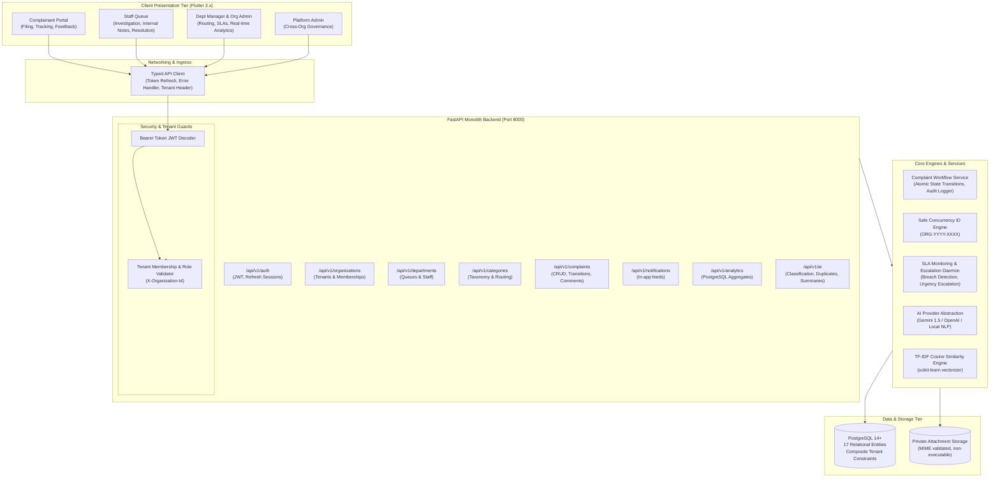
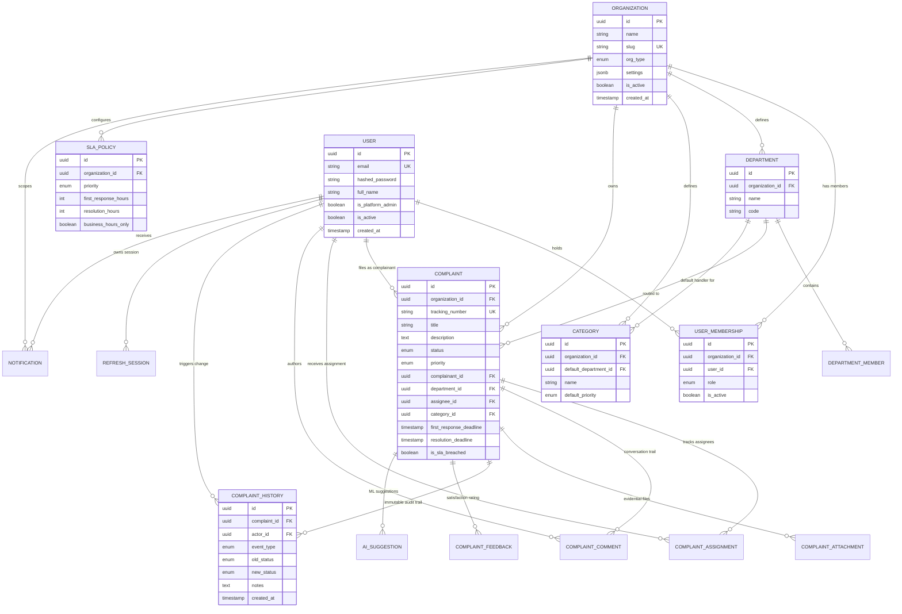
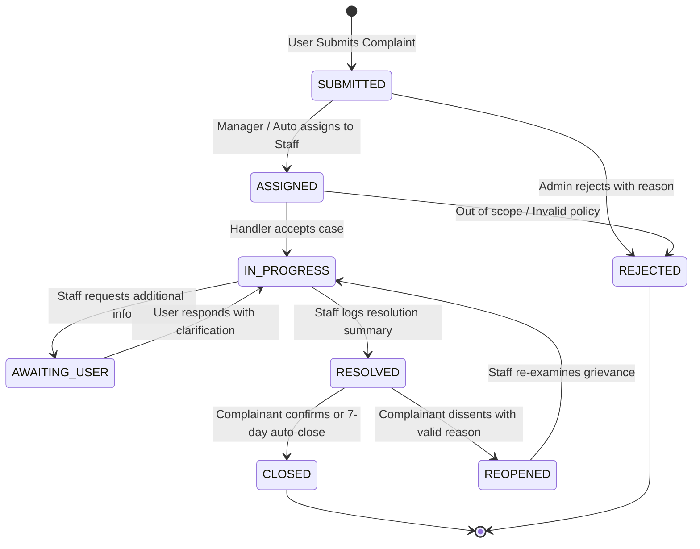

# Technical Architecture Specification
## Universal Complaint Management System

---

## 1. Executive Architecture Summary

The **Universal Complaint Management System** is engineered as a high-integrity, multi-tenant grievance management platform designed to cater to four distinct institutional domains:
1. **Colleges & Universities** (`COLLEGE`) — Campus labs, academics, hostels, examinations.
2. **Commercial & Customer-Facing Enterprises** (`BUSINESS`) — Delivery, logistics, refunds, product quality.
3. **Municipalities & Public Service Authorities** (`PUBLIC_SERVICE`) — Roads, sanitation, electricity, water boards.
4. **Corporate Workplaces** (`CORPORATE`) — IT support, facilities, HR workplace ethics, security.

### Core Architectural Pillars
- **Zero-Trust Multi-Tenancy:** Isolation enforced via composite foreign keys, tenant context dependencies (`X-Organization-Id`), and strict organization boundary checks.
- **Strict State Machine Workflow:** Deterministic lifecycle with 8 valid statuses, explicit forbidden transitions, transaction-isolated audit logging, and automated SLA breach escalation.
- **Dual AI Engine:** Pluggable AI architecture supporting Google Gemini / OpenAI with an honest, zero-dependency local NLP fallback (TF-IDF cosine similarity and pattern heuristic classifiers).
- **Modern Mobile & Desktop Frontend:** Feature-first Flutter client adhering to Material 3 design tokens, platform-adaptive networking (Android emulator `10.0.2.2`, physical LAN, or `127.0.0.1` web/desktop), and role-tailored reactive dashboards.

---

## 2. System Architecture Diagram

---

## 3. Database Entity-Relationship Model (17 Entities)

---

## 4. Complaint State Machine

The complaint workflow enforces an immutable state machine where illegal transitions are rejected with HTTP 400 and logged to the security audit trail.

### State Transition Validation Matrix
| From Status | Permitted Target Statuses | Authorized Roles | Mandatory Requirements |
|---|---|---|---|
| `SUBMITTED` | `ASSIGNED`, `REJECTED` | `ADMIN`, `MANAGER` | `REJECTED` requires explanation notes. |
| `ASSIGNED` | `IN_PROGRESS`, `ASSIGNED`, `REJECTED` | `STAFF`, `MANAGER`, `ADMIN` | Staff can accept or reassign. |
| `IN_PROGRESS` | `AWAITING_USER`, `RESOLVED`, `ASSIGNED` | `STAFF`, `MANAGER`, `ADMIN` | `RESOLVED` requires resolution summary. |
| `AWAITING_USER` | `IN_PROGRESS` | `COMPLAINANT`, `STAFF`, `ADMIN` | Transition triggered by user clarification. |
| `RESOLVED` | `CLOSED`, `REOPENED` | `COMPLAINANT`, `ADMIN` | `REOPENED` requires user dissatisfaction notes. |
| `REOPENED` | `IN_PROGRESS`, `ASSIGNED` | `STAFF`, `MANAGER`, `ADMIN` | Restarts resolution investigation. |

---

## 5. Multi-Tenant Boundary Enforcement

Isolation is enforced through 3 redundant safety tiers:
1. **Request Ingress Verification:** The `get_current_tenant_membership` FastAPI dependency extracts the `X-Organization-Id` header and asserts that the authenticated user holds an active membership record in that organization.
2. **Repository Composite Scoping:** Every SQL query explicitly scopes queries with `.filter(Entity.organization_id == membership.organization_id)`.
3. **Cross-Tenant Constraint Checks:** When creating a complaint, the backend ensures the selected `category_id` and `department_id` strictly belong to the active tenant. Attempting to mix resources results in HTTP 400 Bad Request.

---

## 6. Dual AI Architecture (Gemini / OpenAI with Offline NLP Fallback)

The AI provider abstraction (`app.ai.provider.AIProvider`) dynamically adapts to configuration:
- **Cloud Mode (`gemini` / `openai`):** When `AI_API_KEY` is provided, requests stream structured JSON prompts to Google Gemini or OpenAI with strict schema validation.
- **Honest Local Fallback Mode (`local_fallback`):** When external keys are absent, the system activates a zero-dependency NLP engine:
  - **Classification:** Uses weighted domain keyword analysis mapped against organization categories and departments.
  - **Duplicate Detection:** Employs `scikit-learn`'s `TfidfVectorizer` to compute pairwise cosine similarity scores against existing complaints in the tenant.
  - **Summarization:** Extracts structured sections (Reported Issue, Evidence, Actions, Outstanding Questions) directly from complaint metadata and comment history.
- **Fail-Safe Guarantee:** All AI operations run defensively. If an external API timeout or rate-limit occurs, the complaint submission succeeds unconditionally with fallback heuristics.
